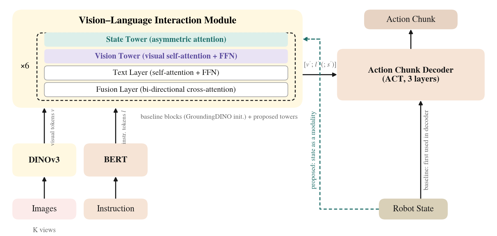
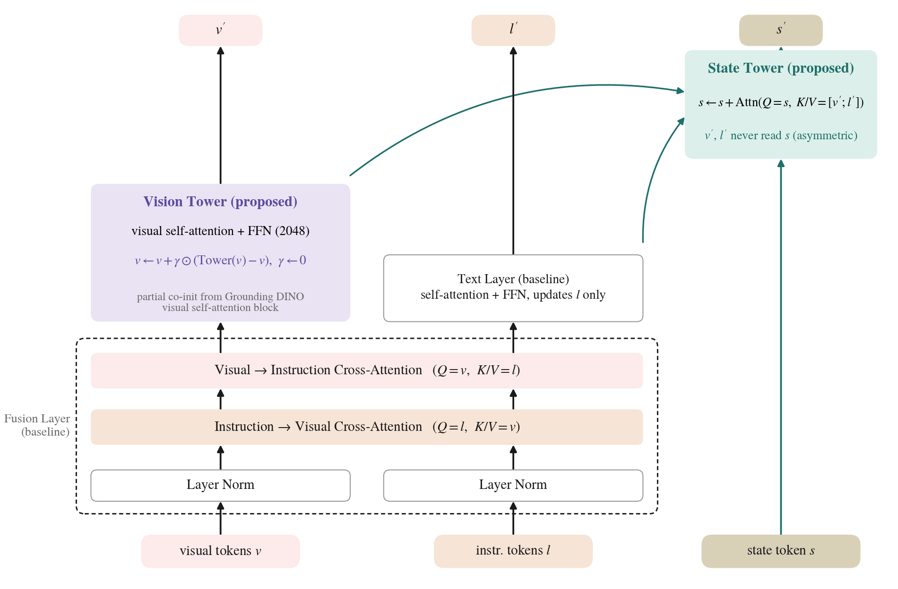
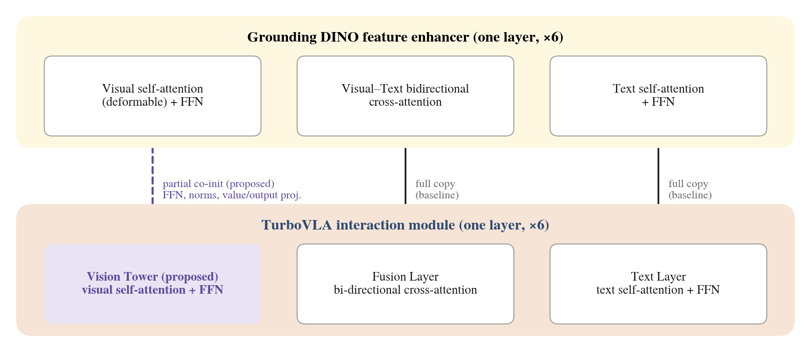
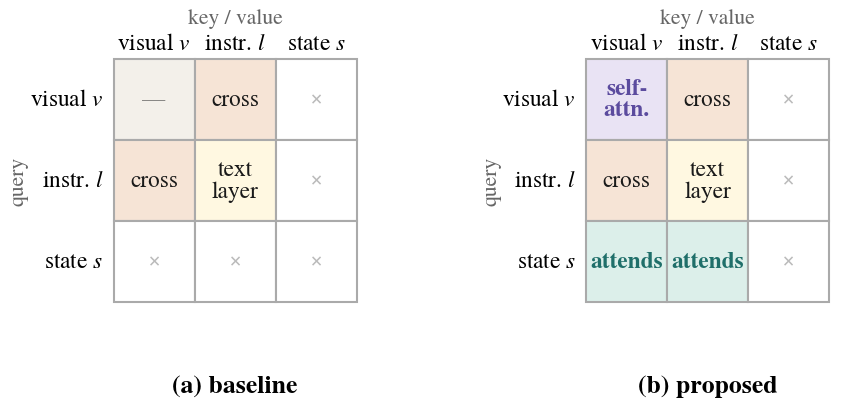
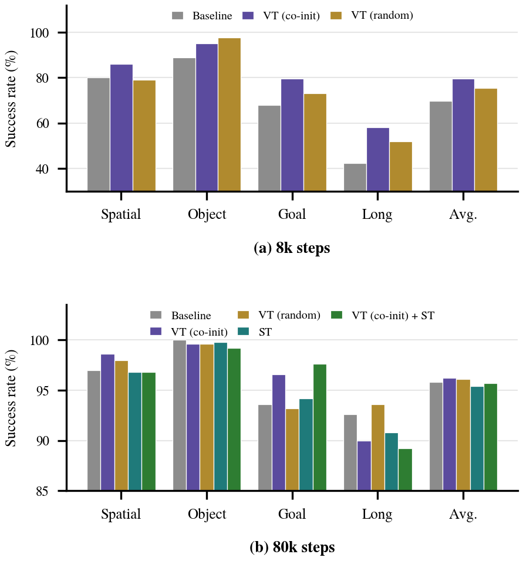
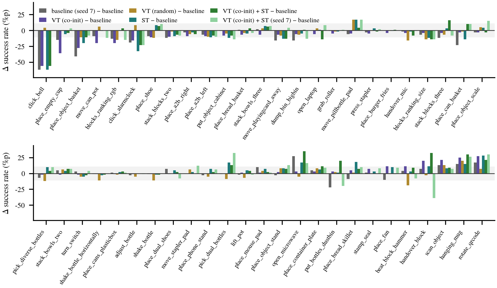
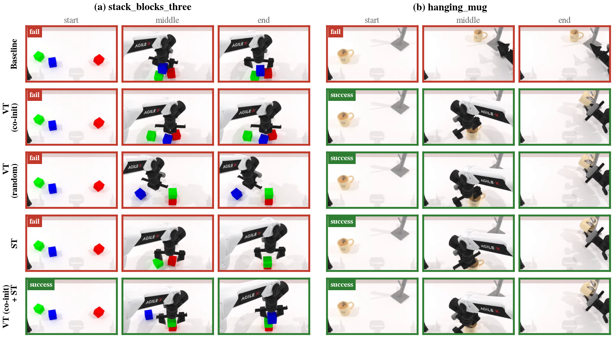

# Design and Analysis of Visual Self-Attention and State Towers for a Lightweight Vision-Language-Action Model
**경량 비전-언어-행동 모델을 위한 시각 셀프 어텐션 타워와 상태 타워의 설계 및 분석**

Hyeon-Sung Choi, Jong-Eun Ha*  
Seoul National University of Science and Technology

- Manuscript for *Journal of Institute of Control, Robotics and Systems* (J. ICROS), submitted 2026/11

[](LICENSE)

> 🚀 This project is built on **[TurboVLA](https://github.com/H-EmbodVis/TurboVLA)** (Xie et al., 2026), a lightweight VLA that runs at 32 Hz on an RTX 4090 with < 1 GB VRAM.  
> The original TurboVLA README is kept at [`docs/README_TurboVLA.md`](docs/README_TurboVLA.md). Everything added here is off by default; with no flag the model is bit-identical to the original.

---

## Abstract

TurboVLA is a lightweight vision-language-action (VLA) model that removes the large language model and fuses visual and instruction tokens through a shallow bidirectional interaction module initialized from the feature enhancer of the open-vocabulary detector Grounding DINO. Inside this module visual tokens never attend to each other, and the robot state enters only at the action decoder. We propose two extensions: a **vision tower**, a visual self-attention block added to every interaction layer and partially co-initialized from the visual self-attention block of the same feature enhancer, and a **state tower** that injects the robot state into the fusion stage through asymmetric attention. The vision tower is wrapped by a zero-initialized gate so that enabling it leaves the model bit-identical to the baseline at the start of training, and a randomly initialized vision tower serves as a control that separates the effect of the architecture from that of weight transfer. On LIBERO, all five configurations converge to 95.4–96.2% after 80k steps, while co-initialization leads the random control by 4.2%p at 8k steps, indicating faster convergence without a change of the end point. On RoboTwin 2.0 (50 bimanual tasks, 100 trials per task), the vision tower scores 2–3%p below the seed-0 baseline, the state tower is neutral, and their combination is the highest configuration in both of its seeds (59.3% and 59.0%). A second baseline seed moves the baseline average by 4.5%p (57.6% → 53.2%), so all differences are read against this range: both combination seeds exceed both baseline seeds (+3.8%p between the two-seed means, a ranking that four exchangeable runs would produce with probability 1/6), while task-level differences stay within seed variation. A qualitative comparison on identical initial layouts shows that the same architecture can succeed or fail depending on initialization.

## Keywords

vision-language-action model · lightweight VLA · co-initialization · asymmetric attention · LIBERO · RoboTwin

---

## Method

<p align="center">
  
  <br>
  <em>Fig. 1. Proposed TurboVLA architecture with the vision and state towers.</em>
</p>

<p align="center">
  
  <br>
  <em>Fig. 2. One layer of the vision-language interaction module. The original layer has text self-attention, bidirectional cross-attention and a text FFN only; the vision tower (visual self-attention + FFN, gated) and the state tower (state → vision/text asymmetric attention) are added per layer.</em>
</p>

<p align="center">
  
  <br>
  <em>Fig. 3. Weight transfer from the Grounding DINO feature enhancer to the TurboVLA interaction module. The feature enhancer's visual self-attention is deformable, so only the value/output projections, FFN and norms are copied; query/key projections stay random.</em>
</p>

<p align="center">
  
  <br>
  <em>Fig. 4. Token reference pattern in one interaction layer. (a) Baseline, (b) proposed.</em>
</p>

Components (all in [`turbovla/models/turbovla.py`](turbovla/models/turbovla.py) unless noted):

1. **Vision tower** (`VisionTower`) – a standard multi-head self-attention + FFN (width 2048) block over the visual tokens, inserted into every interaction layer. Its output is added through a **zero-initialized per-channel gate** (LayerScale, γ = 0), so at step 0 the network equals the baseline.
2. **Partial co-initialization** ([`turbovla/models/coinit.py`](turbovla/models/coinit.py)) – the `transformer.encoder.layers` of the Grounding DINO checkpoint, which TurboVLA never loaded, are mapped onto the vision tower: `linear1/linear2/norm1/norm2` by name, `self_attn.value_proj → in_proj[V]`, `self_attn.output_proj → out_proj`. The deformable sampling offsets and attention weights have no counterpart and are dropped, so Q/K remain random. `--no_vision_tower_coinit` keeps the same block randomly initialized (the control).
3. **State tower** (`StateTower`) – the robot state is projected to tokens and, in every layer, attends to the visual and text tokens (**asymmetric**: state reads from the streams, the pretrained streams never read from state). The updated state tokens are passed to the action decoder ([`turbovla/models/action_head.py`](turbovla/models/action_head.py)).
4. **Learning-rate groups** – parameters that received no pretrained weights (vision-tower Q/K and the gate) use `vision_tower_lr_mult` × base LR (5×, following Cosmos 3); everything else, including the state tower, uses the base LR ([`turbovla/training/trainer.py`](turbovla/training/trainer.py), and `extra_param_lr_groups` in the starVLA runtime for RoboTwin).

All options live in `InteractionConfig` ([`turbovla/models/configuration.py`](turbovla/models/configuration.py)):

| Option | Default | Meaning |
|---|---|---|
| `vision_tower` | `False` | add the visual self-attention tower to every layer |
| `vision_tower_coinit` | `True` | co-initialize it from Grounding DINO (`False` = random control) |
| `vision_tower_ffn` / `vision_tower_nheads` | `2048` / `8` | tower width (2048 is the only width that copies Grounding DINO's FFN uncut) |
| `vision_tower_lr_mult` | `5.0` | LR multiplier for the randomly initialized tower parameters |
| `state_as_modality` | `False` | add the state tower |
| `state_tower_ffn` | `512` | state tower FFN width |
| `layer_tap` / `layer_tap_stride` | `False` / `2` | experimental, not used in the paper |

The five configurations of the paper are: **Baseline**, **VT (co-init)**, **VT (random)**, **ST**, **VT (co-init) + ST**.

---

## Results

All runs use two RTX 4090 (24 GB) GPUs. LIBERO: one model on the four suites (spatial/object/goal/long), global batch 256, 80k steps, 50 trials × 10 tasks per suite (2,000 episodes per configuration). RoboTwin 2.0: 50 bimanual tasks (clean setting), DINOv3 ViT-L backbone, 55k steps, 100 trials per task (5,000 episodes per configuration). Following the original TurboVLA paper, only success rates are reported (no significance tests); on RoboTwin the baseline and the combination were trained twice (seeds 42 and 7; the paper calls them seed 0 and seed 7) to show the size of seed variation.

**Table 1. LIBERO success rate at 8k steps (%)** – co-initialization vs. the random control

| Suite | Baseline | VT (co-init) | VT (random) | co-init − random |
|---|---:|---:|---:|---:|
| spatial | 80.0 | 86.0 | 79.0 | +7.0 |
| object | 88.8 | 95.0 | 97.6 | −2.6 |
| goal | 68.0 | 79.6 | 73.2 | +6.4 |
| long | 42.4 | 58.0 | 52.0 | +6.0 |
| **Average** | 69.8 | **79.7** | 75.5 | **+4.2** |

**Table 2. LIBERO success rate at 80k steps (%)** (Paper = numbers reported in the TurboVLA paper, 4 GPUs)

| Suite | Paper | Baseline | VT (co-init) | VT (random) | ST | VT (co-init) + ST |
|---|---:|---:|---:|---:|---:|---:|
| spatial | 99.2 | 97.0 | 98.6 | 98.0 | 96.8 | 96.8 |
| object | 99.8 | 100.0 | 99.6 | 99.6 | 99.8 | 99.2 |
| goal | 97.4 | 93.6 | 96.6 | 93.2 | 94.2 | 97.6 |
| long | 94.2 | 92.6 | 90.0 | 93.6 | 90.8 | 89.2 |
| **Average** | 97.7 | 95.8 | 96.2 | 96.1 | 95.4 | 95.7 |

<p align="center">
  
  <br>
  <em>Fig. 7. LIBERO success rate per suite. (a) 8k steps, (b) 80k steps.</em>
</p>

**Table 3. RoboTwin 2.0 success rate (%)** – W/L/T compares the seed-42 run of each configuration with the two baseline seeds task by task

| Configuration | Seed 42 | Seed 7 | Avg. | W/L/T vs. baseline seed 42 | W/L/T vs. baseline seed 7 |
|---|---:|---:|---:|---:|---:|
| Baseline | 57.6 | 53.2 | 55.4 | — | — |
| VT (co-init) | 54.4 | — | — | 14/33/3 | 25/21/4 |
| VT (random) | 55.7 | — | — | 17/31/2 | 23/26/1 |
| ST | 57.8 | — | — | 28/21/1 | 30/16/4 |
| **VT (co-init) + ST** | **59.3** | **59.0** | **59.2** | 27/18/5 | 34/14/2 |

<p align="center">
  
  <br>
  <em>Fig. 8. Per-task success-rate difference on RoboTwin 2.0 (relative to the seed-42 baseline). The grey bars (baseline seed 7 − seed 42) show how much a seed change alone moves each task.</em>
</p>

<p align="center">
  
  <br>
  <em>Fig. 9. Qualitative comparison on RoboTwin 2.0 with identical initial layouts. (a) stack_blocks_three, (b) hanging_mug.</em>
</p>

**Summary.** Partial co-initialization speeds up the early phase (+4.2%p at 8k) but does not change the convergence point. Either tower alone does not move the final success rate. The combination is the best configuration on RoboTwin 2.0 in both seeds and exceeds both baseline seeds (+3.8%p between two-seed means); its task-level gains, however, move with the seed (task-level SD between the two combination seeds is 16.9%p), so no claim is made about particular task types.

---

## Setup and usage

See [`setup.md`](setup.md) for environment setup, data preparation, and the exact commands used for every run (LIBERO and RoboTwin training, evaluation, resume).

Quick reference (after `source setup/00_env.sh`):

```bash
# LIBERO: baseline / vision tower / random control / state tower / combination
bash setup/13_libero_train.sh
bash setup/13_libero_train.sh --vision_tower
bash setup/13_libero_train.sh --vision_tower --no_vision_tower_coinit
bash setup/13_libero_train.sh --state_as_modality
bash setup/13_libero_train.sh --vision_tower --state_as_modality

# RoboTwin 2.0: MODE = coinit | random | state | combo  (baseline: setup/05_robotwin_train.sh)
MODE=combo bash setup/20_robotwin_vision_tower.sh
MODE=combo bash setup/21_robotwin_eval_ours.sh
```

---

## Repository layout

```
turbovla/                  model, training, evaluation (modified: models/turbovla.py, action_head.py,
                           configuration.py, training/trainer.py; new: models/coinit.py)
third_party/starvla_runtime/   RoboTwin training runtime (modified: TurboVLA adapter, trainer LR groups,
                           gradient accumulation with DeepSpeed ZeRO-2)
experiments/               LIBERO / RoboTwin entry points and configs (upstream)
scripts/                   upstream helper scripts
setup/                     our shell scripts: assets, data, training, evaluation, resume (numbered in order)
figs/                      paper figures
docs/README_TurboVLA.md    original TurboVLA README
```

## Acknowledgements

This work builds on [TurboVLA](https://github.com/H-EmbodVis/TurboVLA), [Grounding DINO](https://github.com/IDEA-Research/GroundingDINO), [DINOv3](https://github.com/facebookresearch/dinov3), [LIBERO](https://github.com/Lifelong-Robot-Learning/LIBERO), [RoboTwin 2.0](https://github.com/RoboTwin-Platform/RoboTwin) and the [starVLA](https://github.com/starVLA/starVLA) runtime. The code is released under the Apache 2.0 license of the original TurboVLA repository.
